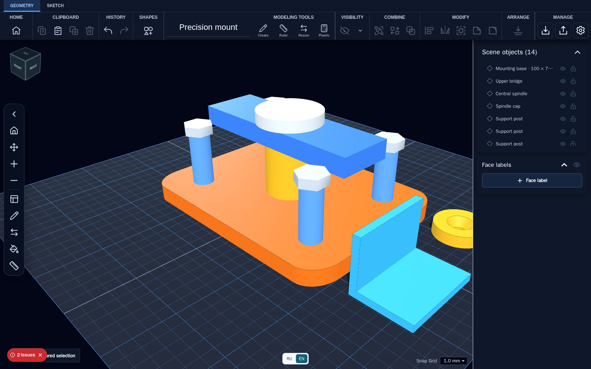

# Scketch3Dweb

**Design practical 3D parts in your browser. Connect AI assistants through MCP. Keep your projects on your own server.**

[](LICENSE)
[](https://www.typescriptlang.org/)
[](#quick-start)



*Actual editor screenshot with synthetic demo parts. No customer projects or account credentials are shown.*

## Features

- **Model parts:** place solids, resize and rotate them, use holes and boolean operations, and group components.
- **CAD and mesh workflows:** import STL, OBJ, STEP, SVG, and native SKF projects; export supported geometry and project files.
- **Measure precisely:** 3D ruler, face labels, hole measurements, workplane controls, and dimension tools.
- **Refine geometry:** edit sketches, extrude profiles, and use chamfer/fillet tools where the underlying geometry supports them.
- **Estimate material:** calculate plastic usage and approximate material cost using your own settings.
- **Project history and collaboration:** private/shared projects, versions, comments, and activity with user permissions.
- **AI-assisted editing:** personal, revocable MCP keys for inspecting and editing your own open editor sessions.
- **Your workspace:** English and Russian interfaces, light/dark palettes, and an optional Electron desktop build.

Scketch3Dweb is self-hosted. No hosted modeling subscription or particular AI provider is required. MCP clients and AI models are configured separately.

## Quick start

Requirements: Docker Engine or Docker Desktop, Docker Compose, and Node.js for the setup helper.

```sh
git clone https://github.com/rjohny55/Scketch3Dweb.git
cd Scketch3Dweb
node scripts/setup-local.mjs
docker compose up --build -d
```

Open **http://127.0.0.1:31880**. On a fresh installation, create the first administrator account and keep its password safe.

For a short setup and maintenance guide, see [START.md](START.md). The interface defaults to English; use **RU / EN** to change it.

The setup helper creates a private `.env` with a random MCP controller token. It does not print the token or replace an existing `.env`.

| Service | Local address |
| --- | --- |
| Web application | `http://127.0.0.1:31880` |
| MCP Streamable HTTP | `http://127.0.0.1:31881/mcp` |

Compose binds both services to loopback by default. Projects and accounts persist in a Docker volume. Set `SCKETCH3DWEB_MODELS_VOLUME` in `.env` to choose a host directory for file-based model import/export.

```sh
docker compose logs -f
docker compose down
```

Do not add `--volumes` when stopping the app unless you intend to remove its stored data.

### Remote access

Keep the default local bindings and use an SSH tunnel:

```sh
ssh -L 31880:127.0.0.1:31880 -L 31881:127.0.0.1:31881 user@your-server
```

Open the same local web address on your computer. Before exposing an installation to the Internet, configure HTTPS, authentication, backups, and access controls.

## AI tools and MCP

1. An administrator enables MCP access for a user.
2. The user creates a personal key in application settings.
3. Copy the connection configuration from the UI into your MCP client.
4. Keep the target editor tab open while issuing commands.

Tools use the `scketch3dweb_` prefix. They can list editors, inspect objects and measurements, create/transform shapes, perform supported geometry operations, capture images, and import/export model files. Keys are scoped to their owner's editors and can be revoked.

Example tasks for a connected assistant:

> Create a mounting plate with four holes, set its dimensions, and report the hole spacing.
>
> Inspect the selected part, measure its faces, and export it as STL.

See [connection examples](docs/mcp) and the [MCP skill](docs/skills/scketch3dweb-mcp-skill/SKILL.md). The stdio bridge is available through `npm run mcp:scketch3dweb`; configure its endpoint and key through environment variables.

## Development

Use **Node.js 26.12.1**; `.nvmrc` and `.node-version` are included.

```sh
npm ci
npm run dev
```

The development server normally starts at `http://localhost:3000`. The pre-dev/build helper stages OCCT WebAssembly from the installed dependency; generated runtime files are not committed.

```sh
npm run typecheck
npm test
npm run build
```

### Desktop application

Download Linux and Windows x64 desktop packages from [GitHub Releases](https://github.com/rjohny55/Scketch3Dweb/releases). Docker and a separate Node.js installation are not required to run the packaged app.

- Linux: AppImage or Debian/Ubuntu `.deb` package.
- Windows: `.exe` installer with a selectable installation directory.

The packages are unsigned. Windows may show an unknown-publisher warning; verify the downloaded file against the release's `SHA256SUMS.txt`. See the [1.0.10 release notes](docs/releases/1.0.10.md).

To build the desktop application from source:

```sh
npm run desktop:dev
npm run desktop:pack
```

Packaging depends on the target OS and build tools. For distributable packages, use `npm run desktop:dist -- --linux --x64 --publish never` or the corresponding `--win` target. Cross-building Windows on Linux requires Wine.

## Project layout

```text
apps/web/       Next.js app, 3D editor, API, and assets
apps/desktop/   Electron wrapper and packaging
scripts/       Setup, MCP bridges, runtime staging, catalog helpers
tests/         Unit, integration, and performance tests
docs/          Project format and MCP documentation
deploy/        Additional container configuration
```

Built with Next.js, React, TypeScript, and Three.js. Geometry tooling includes Manifold, OCCT WebAssembly, and related libraries.

## Limitations and safety

- Large meshes and complex boolean operations can require substantial browser memory and processing time.
- A model that looks correct is not necessarily printable. Check topology, wall thickness, tolerances, and slicer output before manufacturing.
- CAD edge operations depend on the geometry and do not work on every arbitrary mesh.
- Material estimates are approximate, not a manufacturing quote or a substitute for a slicer.
- Never commit `.env`, MCP keys, account data, or private models. Do not expose the MCP controller without access controls.
- Older installations with different technical names require an explicit configuration/data migration. Desktop packages use this repository's GitHub release channel; server/Docker automatic update delivery remains unconfigured.

## Contributing

Bug reports and focused pull requests are welcome. Include reproduction steps, browser/OS details, and a small synthetic example when possible. Do not attach private projects, tokens, or personal data. Run relevant tests and the production build before submitting changes.

## License

Application code is available under **MIT OR Apache-2.0**, at your option. See [LICENSE](LICENSE), [LICENSE-MIT](LICENSE-MIT), and [LICENSE-APACHE](LICENSE-APACHE).

Third-party libraries and bundled assets retain their own terms. RP1 catalog assets include separate notices and license information in [apps/web/public/assets/robot-rp1](apps/web/public/assets/robot-rp1). The application license does not relicense those materials.

## Star History

If Scketch3Dweb is useful to you, consider giving the project a star.

<a href="https://www.star-history.com/?repos=rjohny55%2FScketch3Dweb&amp;type=date">
  <picture>
    <source media="(prefers-color-scheme: dark)" srcset="https://api.star-history.com/chart?repos=rjohny55/Scketch3Dweb&amp;type=date&amp;theme=dark" />
    <source media="(prefers-color-scheme: light)" srcset="https://api.star-history.com/chart?repos=rjohny55/Scketch3Dweb&amp;type=date" />
    
  </picture>
</a>
