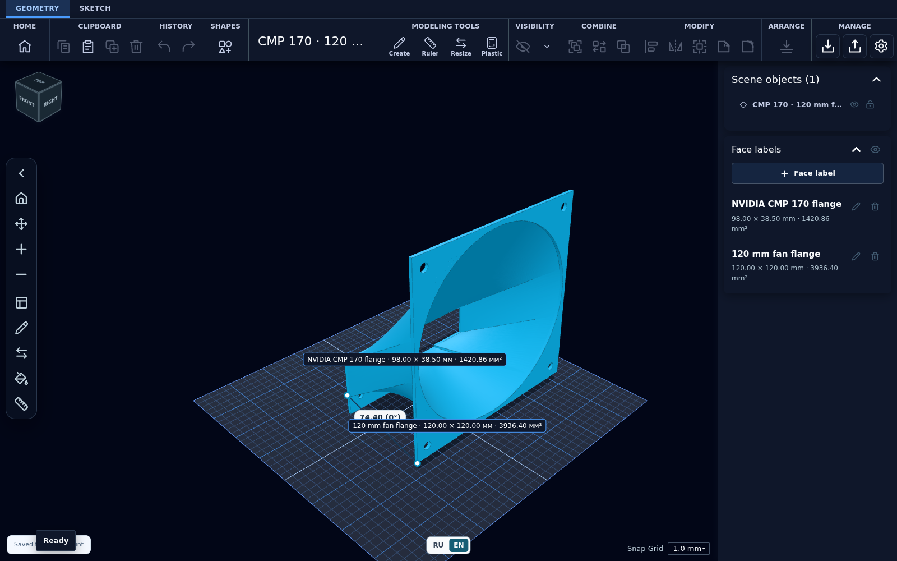

# Scketch3Dweb 1.0.11

Adds a real fitted hardware model as a built-in editable example: **a flange adapter connecting a 120 × 120 mm fan to an NVIDIA CMP 170 graphics card**.

## Changes

- Added the CMP 170 fan adapter card to Home, with one-click opening as a new editable project and automatic camera framing.
- Included separate SKF and STL downloads in the interface, source repository, and release assets.
- Preserved the final fitted geometry, named both flange faces, and restored the verified 74.4 mm point-to-point ruler measurement.
- Added real model/editor screenshots and documented dimensions, checksums, and printing limitations.
- Kept the robot demo and all existing user projects intact.
- Added regression checks for SKF import, flange labels, the ruler, and mesh integrity.

## Downloads

- **Windows x64:** `Scketch3Dweb-Setup-1.0.11-x64.exe`.
- **Linux x64:** `Scketch3Dweb-1.0.11-x86_64.AppImage` or `Scketch3Dweb-1.0.11-amd64.deb`.
- **Model:** `cmp170-120mm-fan-adapter.skf` and `cmp170-120mm-fan-adapter.stl`.
- **SHA256SUMS.txt:** checksums for the released application, model, and updater files.

Packages include Electron and the local web service; Docker and a separate Node.js installation are not required. These builds are unsigned. Windows may display an unknown-publisher/SmartScreen warning. Download only from this repository and verify the checksums.

For installation instructions and desktop data locations, see the [1.0.10 guide](https://github.com/rjohny55/Scketch3Dweb/blob/v1.0.11/docs/releases/1.0.10.md). Substitute the 1.0.11 filenames above. The separate MCP bridge remains configured from the source/Docker setup.

## About the model

The saved ruler distance is 74.4 mm, with an 11 mm lateral difference; the axial mesh span is approximately 73.5823 mm. The fan size is nominally 120 × 120 mm. See the [example documentation](https://github.com/rjohny55/Scketch3Dweb/tree/v1.0.11/examples/cmp170-fan-adapter) for the full specification.

Check fit, clearances, material, and slicer settings before printing. The model is an owner-provided example, not an official NVIDIA accessory or a certified production part.

Windows packages are cross-built on Linux; a native Windows desktop/installer acceptance test remains outstanding.

## Verification

- Production web build, TypeScript checking, and all 429 unit tests passed.
- Opening the built-in model was checked in the browser and the packaged Linux desktop application: both flange labels are valid, the ruler reads 74.4 mm, and the editor renders with WebGL.
- Desktop account creation, the GitHub version link, asset downloads, and login after restart passed the packaged smoke test.
- The final model retains all 37,256 triangles. Basic closed-mesh checks passed; printing/thermal suitability still requires your own validation.
