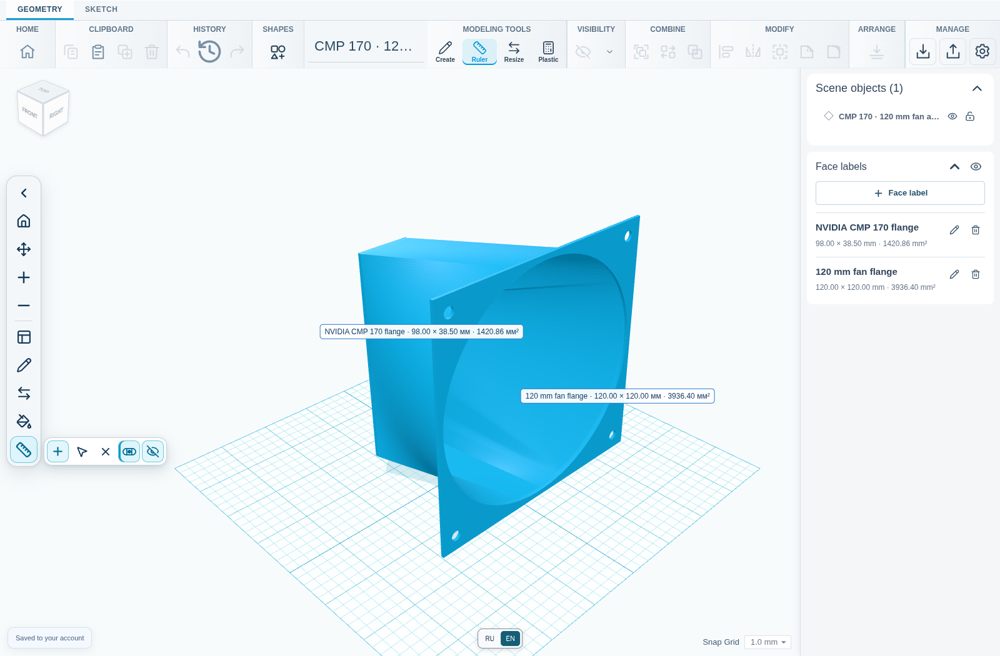

# NVIDIA CMP 170 — 120 mm fan flange adapter

Flange adapter connecting a **120 × 120 mm fan** to an **NVIDIA CMP 170 graphics card**. This is the fitted model previously edited in Scketch3Dweb, not a newly generated approximation.

## Files

- [Editable project — SKF](cmp170-120mm-fan-adapter.skf): the current owner-fitted mesh, two named flange faces, and 12 ruler measurements. Open it in Scketch3Dweb 1.0.12 or later.
- [Triangle mesh — STL](cmp170-120mm-fan-adapter.stl): millimeters, Z-up, for inspecting and preparing in a slicer.
- [Manifest](manifest.json): geometry details, file checksums, and original input checksums.
- [Model preview](preview.png) and [editor screenshot](editor-preview.png): actual renders from the built-in project.

The application includes this model on its Home screen. **Open fan adapter demo** creates an editable copy; edits never overwrite the bundled original. SKF and STL can also be downloaded directly from that card.

## Fitted dimensions

| Item | Value |
| --- | --- |
| Nominal fan size | 120 × 120 mm |
| First saved point-to-point ruler | 14.5 mm |
| Saved measurements | 12 |
| Axial span | 53 mm |
| Overall mesh bounds, Z-up | Approximately 53 × 120 × 120.1172 mm |
| Editing orientation | X rotation 90°, as in the owner's local project |
| Triangle count | 41,524 |

The first ruler measures a local 14.5 mm feature, not the axial bounding-box span. The flanges are named **NVIDIA CMP 170 flange** and **120 mm fan flange**. The demo opens in the same editing orientation as the current local model; no initial manual rotation is required.

## Geometry and printing

Version 1.0.12 refreshes the demo from the owner's current fitted project. Its shape, dimensions, editing rotation and measurements are retained. The STL is exported in that physical orientation. Only the active model state is included: private account metadata and the owner's editing history are not distributed. Public project identifiers and flange labels are normalized for the example.

Basic mesh checks cover closed boundaries, manifold edge counts, finite coordinates, winding, and nondegenerate triangles. They do not certify wall thickness, self-intersections, thermal suitability, printability, or compatibility with every CMP 170 shroud and fan. Check dimensions, mounting clearance, material, and slicer settings before printing or fitting the part. This is not an official NVIDIA accessory.

This owner-provided example is distributed under the project's **MIT OR Apache-2.0** license. NVIDIA product names identify the intended hardware and do not imply endorsement.
